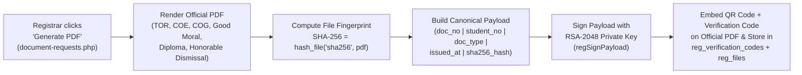
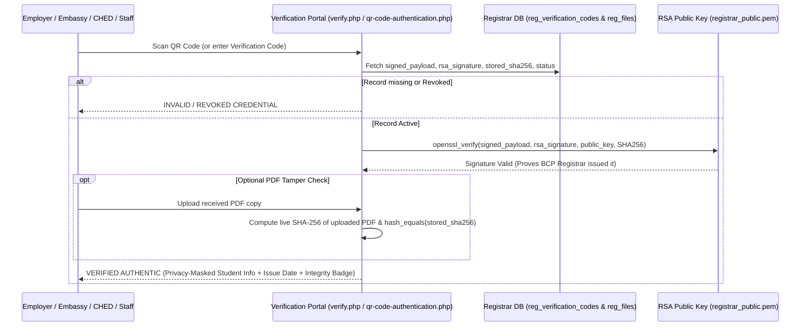

# SMS 2.0 — Registrar Cryptographic Architecture: SHA-256 & RSA-2048

> **Document Purpose:** Complete architectural guide explaining **where SHA-256 and RSA-2048 belong** across the **Office of the Registrar Module** (`modules/registrar/`), what is already implemented in the codebase, what should be completed next, and where *not* to misuse them.  
> **Standards Alignment:** FIPS 180-4 (SHA-256), PKCS #1 / RSASSA-PKCS1-v1_5 (`OPENSSL_ALGO_SHA256`, 2048-bit RSA), Republic Act No. 10173 (Data Privacy Act — Masked Public Verification), National Archives of the Philippines (NAP) Record Integrity.

---

## 1. Fundamental Concept: Why Both SHA-256 and RSA Are Needed

SHA-256 and RSA solve **two different security problems**. Using them together (`RSA-SHA256`) creates tamper-proof, unforgeable academic credentials.

| Algorithm | Role | Security Guarantee | Plain-English Analogy |
|---|---|---|---|
| **SHA-256** *(Cryptographic Hash)* | Computes a unique 64-character hex fingerprint of any file or record (`hash('sha256', ...)`) | **Integrity (Tamper Detection)** — Changing even 1 letter, 1 pixel, or 1 grade completely changes the hash | A **tamper-evident wax seal** showing whether the contents were altered |
| **RSA-2048** *(Asymmetric Keypair)* | **Private Key** (`registrar_private.pem`) signs; **Public Key** (`registrar_public.pem`) verifies (`openssl_sign` / `openssl_verify`) | **Authenticity & Non-Repudiation** — Proves *only* the BCP Office of the Registrar issued it | A **unique notary stamp** that only the Registrar possesses, yet anyone can verify |
| **RSA-SHA256** *(Combined Digital Signature)* | Hash the document/metadata with **SHA-256**, then sign that digest with the **RSA-2048 Private Key** | **Unforgeable + Tamper-Proof** — Third parties (employers, embassies, CHED) can verify both origin and exact contents without needing any secret key | An **official notarized digital fingerprint** embedded inside a QR code |

---

## 2. End-to-End Cryptographic Flow

### 2.1 Issuance & Signing Flow (Document Requests)

### 2.2 Public & Internal Verification Flow (QR Auth & `verify.php`)

---

## 3. Master Placement Matrix Across the Registrar Module

| Priority | Registrar Feature / Page | Best Algorithm | Why It Belongs Here | Current Codebase Status |
|---|---|---|---|---|
| **Tier 1 (Core Showcase)** | **1. Official Document Generation & Release** `pages/document-requests.php` `includes/signing-service.php` `includes/registrar-service.php` | **RSA-2048 + SHA-256** | Official credentials (**TOR, COE, COG, Good Moral, Diploma, Honorable Dismissal**) are the #1 target of academic forgery. | **Backend Implemented** (`regInitializeKeys()`, `regSignPayload()`, `hash_file('sha256')` in `registrar-service.php` L309–339). Needs visible signed status badge in Review Modal. |
| **Tier 1 (Core Showcase)** | **2. QR Code Authentication & Public Verifier** `pages/qr-code-authentication.php` `verify.php` `api/documents.php?action=verify` | **RSA-2048 + SHA-256** | Makes cryptography **visible, interactive, and testable** — live QR/code lookup, RSA signature proof, PDF upload tamper-check, key fingerprint display, and QR revocation. | **Needs Completion** (`qr-code-authentication.php` is currently a placeholder; `verify.php` checks `verification_token` only and should also invoke `regVerifySignature()` + PDF SHA-256 check). |
| **Tier 1 (Core Integrity)** | **3. Digital File Storage Vault** `pages/digital-file-storage.php` `includes/storage-service.php` `api/files.php` & `api/download.php` | **SHA-256** | Proves archived admission records (**Form 137, Form 138, PSA Birth Cert, Good Moral, Barangay Clearance**) have not been corrupted or swapped on disk. | **Implemented for Registrar Uploads** (`regStoreUploadedFile()`, `regVerifyFileIntegrity()`, auto-checked in `download.php` L53–59). *Gap:* Student Portal (`submit-documents.php`) must also hash uploads with SHA-256. |
| **Tier 2 (High-Value Upgrade)** | **4. Student ID Generation (Anti-Fake ID QR)** `pages/student-id-generation.php` `api/id-cards.php` & `api/credentials.php` | **RSA-2048** | Prevents fake Student IDs made with free QR websites. Signs compact ID payload (`student_no \| id_no \| expiry`) with RSA private key so campus/attendance scanners verify authenticity offline or online. | **Planned Upgrade** (Currently ID cards store metadata only; bind RSA-signed QR payload into `reg_credentials` when generating IDs). |
| **Tier 2 (Audit Integrity)** | **5. Finalized Grades & Status Audit Ledger** `pages/academic-history.php` `pages/student-status-tracker.php` | **SHA-256 Hash Chain** *(+ Optional RSA Term Seal)* | Detects **direct database tampering** (e.g., someone altering a grade from `5.00` to `1.25` directly inside MySQL/phpMyAdmin bypassing the app). | **Future Enhancement** (Best implemented once LMS pushes finalized locked grades). |

---

## 4. Detailed Breakdown of the 5 Best Placement Areas

### 4.1 Official Document Requests & PDF Generation (`RSA-2048 + SHA-256`)
- **Files:** `modules/registrar/pages/document-requests.php`, `modules/registrar/includes/signing-service.php`, `modules/registrar/includes/registrar-service.php`, `modules/registrar/includes/document-engine.php`, `modules/registrar/includes/template-engine.php`
- **What Gets Hashed (SHA-256):** The exact generated PDF file bytes (`hash_file('sha256', $pdfPath)`), stored in `reg_files.sha256_hash` and `reg_verification_codes.document_hash`.
- **What Gets Signed (RSA-2048):** A canonical structured string containing:
  `document_no | student_number | doc_type | issued_at | pdf_sha256_hash`
- **Why Both Are Essential Here:**
  - Without **SHA-256**, someone could alter the grades/name inside a downloaded PDF using a PDF editor.
  - Without **RSA-2048**, an attacker could compute their own SHA-256 of a fake PDF and claim it's valid. Because the payload is signed with the Registrar's private key, forging a signature is computationally infeasible.
- **UI Polish Opportunity:** Inside `document-requests.php`'s Review Modal, display a crisp **"RSA-2048 Signed & SHA-256 Sealed"** badge alongside the Verification Code and a one-click **"Open Public Verification Link"** button.

### 4.2 QR Code Authentication Console & Public Verification Portal (`RSA-2048 + SHA-256`)
- **Files:** `modules/registrar/pages/qr-code-authentication.php`, `verify.php`, `modules/registrar/api/documents.php`
- **Two Complementary Interfaces:**
  1. **Internal Registrar Console (`pages/qr-code-authentication.php`):**
     - **Live Verification Tester:** Paste a verification code or scan QR → runs `regVerifySignature()` (RSA public key check) and shows full cryptographic verification details (Algorithm, Key Fingerprint, Signature Status, Verification Count).
     - **PDF Tamper Detector (Drag & Drop):** Upload any PDF presented by a student/applicant → computes its live SHA-256 and checks it against `reg_files` / `reg_verification_codes` to prove immediately whether the file is untouched or edited!
     - **Issued QR & Signature Ledger:** Searchable table of every signed document/student QR with scan counts (`verified_count`), status (`Active` / `Revoked`), and a **Revoke & Re-Issue** action with audit reason.
     - **RSA Keypair Health Panel:** Displays key status (`2048-bit RSA Active`), Public Key SHA-256 Fingerprint, and a "Download Public Key (`.pem`)" button for external auditors/CHED.
  2. **Public Unauthenticated Verifier (`verify.php`):**
     - Already enforces **RA 10173 Privacy Masking** (`J**N D*E`, `2021-***45`).
     - Upgrade `verify.php` to verify **both** the database token AND the **RSA-2048 cryptographic signature** (`openssl_verify`), increment `verified_count` (with rate limiting), and optionally allow employers to drop the PDF file to confirm its SHA-256 hash matches!

### 4.3 Digital File Storage Vault (`SHA-256`)
- **Files:** `modules/registrar/pages/digital-file-storage.php`, `modules/registrar/includes/storage-service.php`, `modules/registrar/api/files.php`, `modules/registrar/api/download.php`
- **How It Works:**
  1. On upload, `regStoreUploadedFile()` computes `$sha256Hash = hash('sha256', $fileContent)` and persists it in `reg_files.sha256_hash`.
  2. Whenever a Registrar clicks **Verify Integrity** (`api/files.php?action=verify`) or downloads a file (`api/download.php` L53–59), the server recomputes the live SHA-256 of the file on disk and compares it using timing-safe `hash_equals()`.
  3. If the file on disk was corrupted, overwritten, or silently swapped, the system immediately blocks download and flags a **Tamper Alert**.
- **Integration Note:** Currently, `modules/student-portal/pages/submit-documents.php` inserts directly into `reg_files` without computing `sha256_hash`. Routing Student Portal uploads through `regStoreUploadedFile()` ensures 100% of stored documents have verifiable SHA-256 fingerprints from Day 1.

### 4.4 Student ID Generation — Anti-Counterfeit ID QR (`RSA-2048`)
- **Files:** `modules/registrar/pages/student-id-generation.php`, `modules/registrar/api/id-cards.php`, `modules/registrar/api/credentials.php`
- **The Threat:** If a Student ID QR code simply encodes `2024-00123`, anyone can generate an identical QR code in 5 seconds and print a counterfeit campus ID.
- **The Cryptographic Solution:**
  - Build a compact payload: `ID|student_no|id_card_no|expiry_date`
  - Sign with the Registrar's **RSA Private Key** (`regSignPayload()`) and bind the active token in `reg_credentials` (`credential_type = 'QR'`).
  - When scanned by Campus Security, Library, Faculty Attendance, or Co-Curricular Event Check-in, verifying the signature with `registrar_public.pem` guarantees the ID was genuinely issued by BCP Registrar and hasn't been revoked or expired.

### 4.5 Academic Grade Ledger & Status Transition Seal (`SHA-256` Hash Chain + Optional `RSA`)
- **Files:** `modules/registrar/pages/academic-history.php`, `modules/registrar/pages/student-status-tracker.php`
- **The Threat (Insider / Direct DB Tampering):** Standard application audit logs don't catch someone with database access running `UPDATE reg_academic_subjects SET grade = 1.25 WHERE id = 42` directly in phpMyAdmin.
- **The Cryptographic Solution:**
  - **Per-Row Record Seal (SHA-256):** When LMS/Registrar locks a grade or logs an official status change, compute:
    `record_hash = SHA-256(student_id | subject_code | academic_year | term | grade | prev_record_hash)`
  - **Term Lock Signature (RSA-2048):** When the Registrar officially closes a semester's grade ledger, sign the Merkle/aggregate SHA-256 digest of that term with the Registrar's RSA private key.
  - **Audit Verification:** An Integrity Audit button can scan the ledger and instantly flag any row whose live computed hash no longer matches its stored seal!

---

## 5. Where NOT to Use SHA-256 or RSA (Important Best Practices)

Understanding where **not** to apply cryptography is just as important as knowing where to apply it:

| Area | Do NOT Use | Use Instead | Why |
|---|---|---|---|
| **User Login Passwords** | Raw `SHA-256` or `RSA` | `password_hash()` (bcrypt / Argon2id) — *already used in your system* | SHA-256 is designed to be *fast*, making brute-force GPU cracking easy; bcrypt/Argon2 is intentionally slow and salted. |
| **High-Frequency Inter-Module APIs** (e.g., Payment ↔ Registrar webhooks) | Slow per-request `RSA` | **Per-Subsystem API Key + `HMAC-SHA256`** | Symmetric HMAC-SHA256 is 100× faster than RSA for trusted server-to-server calls where both servers securely hold a shared secret. Reserve RSA for documents/IDs verified by external parties. |
| **Everyday Search / Table Filtering** | Any signing/hashing per row view | Standard indexed SQL queries | Signing/hashing belongs at **issuance, upload, lock, and verification** checkpoints — never inside table rendering loops. |

---

## 6. Key Protection & Production Security Rules

For RSA-2048 to remain genuinely trustworthy on a live domain:

1. **Protect the Private Key (`storage/keys/registrar_private.pem`):**
   - Must NEVER be committed to Git (`.gitignore` must exclude `storage/keys/*.pem`).
   - Block all web access to `storage/` and `storage/keys/` via root `.htaccess` (or place `storage/keys/` outside `public_html` / web root).
   - Restrict OS file permissions (`chmod 0600` on Linux hosting).
2. **Expose Only the Public Key (`registrar_public.pem`):**
   - The public key is safe to share with external verifiers, peer subsystems, or CHED auditors — it can **only verify**, never sign.
3. **Never Expose Raw Personal Data on Public QR Scans:**
   - Keep `verify.php`'s **RA 10173 privacy masking** (`J**N D*E`, `2021-***45`) so anyone scanning a lost printed certificate cannot harvest full personal student details, while an employer holding the physical certificate can still confirm it matches.
4. **Support Key Rotation & Revocation:**
   - Store a `key_id` (fingerprint) alongside each signature in `reg_verification_codes` so rotating the Registrar's RSA keypair in future years does not break verification of older graduated students' transcripts.

---

## 7. Quick Panel / Thesis Defense Q&A Cheat Sheet

**Q1: Why use BOTH SHA-256 and RSA instead of just SHA-256?**  
> *Answer:* SHA-256 alone only checks whether a file changed — anyone can create a fake transcript and calculate its SHA-256 hash. Adding **RSA-2048** binds that hash to the Registrar's private key, proving the document was authentically issued by **Bestlink College of the Philippines** and cannot be forged.

**Q2: What happens if a student edits their downloaded COE or TOR PDF in Photoshop or a PDF editor?**  
> *Answer:* Changing even a single character or pixel completely alters the PDF's **SHA-256 hash**. When verified against the Registrar's stored hash and RSA signature, the integrity check immediately fails and flags the document as **Tampered / Invalid**.

**Q3: What if someone copies a real QR code from a genuine COE onto a fake TOR?**  
> *Answer:* When an employer scans the QR code on `verify.php`, the verification screen displays the **original document type, issue date, and masked student identity** from the RSA-signed payload (e.g., *Certificate of Enrollment*), immediately exposing the mismatch — and uploading the PDF fails the SHA-256 file hash comparison.

**Q4: Why is the student's name partially masked on `verify.php`?**  
> *Answer:* To comply with the **Philippine Data Privacy Act of 2012 (RA 10173)**. If a printed certificate is misplaced, a stranger scanning the QR cannot extract full personal PII, while an employer already holding the document can visually verify the masked initials, student number suffix, document type, and cryptographic authenticity.

**Q5: How do you protect the RSA Private Key on a live server?**  
> *Answer:* `registrar_private.pem` is stored in a web-blocked directory (`storage/keys/` with `.htaccess` deny + `0600` permissions, excluded from Git), never sent to the browser, and used strictly server-side by `signing-service.php`. Only the public key is used for verification.
