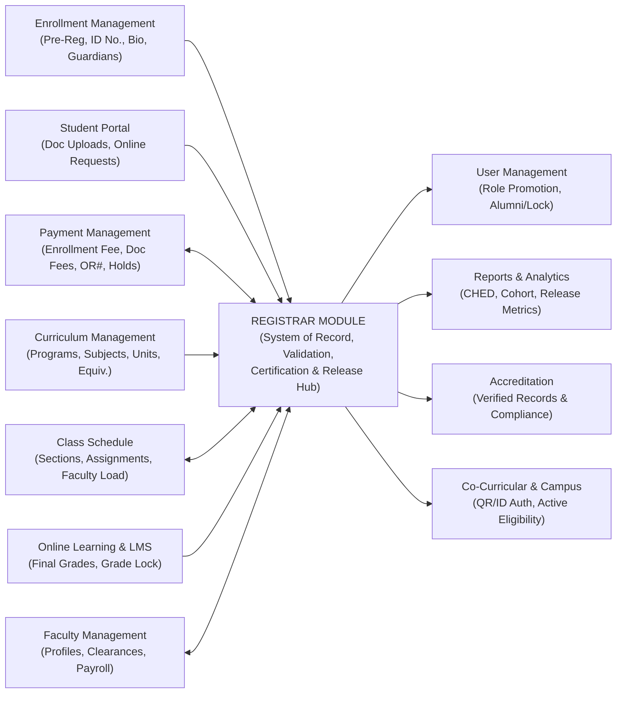

# SMS 2.0 — Registrar Module Cross-Subsystem Integration Blueprint

> **Document Purpose:** Master cutover & refactoring playbook for when the **Registrar Module** (`modules/registrar/`) transitions from **Standalone Development Mode** into **Full Multi-Subsystem Production Integration** with peer SMS 2.0 modules.  
> **Status:** Planning & Readiness Blueprint (**No code modified yet**)  
> **Scope:** All 15 Registrar pages, `index.php`, `student-dossier-drawer.php`, all 15 Registrar API endpoints, `includes/` services, and cross-module contracts.

---

## 1. Core Architectural Shift: Custodian & Gatekeeper (Not Upstream Data Entry)

During standalone development, manual **Add / Create / Batch-Add / Upload / Delete / Mark Paid** buttons were intentionally kept inside Registrar so pages could be tested independently.

Once peer subsystems go live, the Registrar's role shifts strictly to **Official System of Record Custodian, Validator, Certifier, and Release Authority**:

| Responsibility | Standalone Mode (Current) | Integrated Mode (Target) |
|---|---|---|
| **Student Creation & Bio Intake** | Registrar has manual Add/Edit/Delete (`student-information-system.php`) | Owned by **Enrollment Management** (`online-pre-registration`, `id-number-generation`) |
| **Guardian & Emergency Info** | Registrar has manual Add/3-Part Add/Delete (`guardian-emergency-contact.php`) | Captured by **Enrollment**, updated via **Student Portal** (Registrar approves changes only) |
| **Student Grades & Subjects** | Registrar has Add Subject / Batch Add / Edit / Delete (`academic-history.php`) | Posted automatically by **LMS & Faculty** (`grading-integration`); Registrar uses immutable **Change-of-Grade / INC** workflow only |
| **Payment & Official Receipts** | Registrar manually toggles `Paid/Unpaid` & types `OR #` (`document-requests.php`), and can activate unpaid students (`validate-credentials.php`) | Owned strictly by **Payment Management** (`payment-collection-portal`, `student-billing-invoicing`, `accounts-receivable-management`) — **Read-only in Registrar + Hard Gatekeeper** |
| **Programs, Strands & Units** | Hardcoded PHP/JS arrays (`student-id-generation.php`, `id-cards.php`, `146` units in `registrar-service.php`) | Read dynamically from **Curriculum & Subject Management** (`curriculum-builder`, `subject-mapping`) |
| **Class Sections & Enrollment Map** | Partially integrated in `masterlist.php` via `schGetEnrollmentMap()` | Fully owned by **Class Schedule** (`section-assignment-tool`, `auto-section-assignment`) |
| **Document Requests & Uploads** | Registrar manually creates requests & uploads files | Primary intake from **Student Portal** (`submit-documents.php` + online request portal); Registrar handles **Walk-In Counter** intake & verification/generation/release |

### High-Level Subsystem Integration Topology



---

## 2. Master Cross-Subsystem Data & Gatekeeper Matrix

| Peer Subsystem | Direction | Tables / Service Contracts | Registrar Impact |
|---|---|---|---|
| **Enrollment Management** (`modules/enrollment`) | Upstream → Registrar | `reg_students` (`Pending`/`Verified`), `reg_guardians`, `reg_academic_history`, `verify-student.php` | Feeds new student bio, student number, prior school background, and guardian contacts. **Removes Registrar's Add Student / Add Guardian / Add Prior School buttons.** |
| **Payment Management** (`modules/payment`) | Bidirectional Gate | `payCheckEnrollmentFee($studentId)`, `payCheckDocumentFee($requestNo)`, `payGetStudentHolds($studentId)`, `payCreateDocumentCharge(...)` | **HARD GATE** on: (1) Student Activation (`validate-credentials.php`), (2) Document PDF Generation & Release (`document-requests.php`), (3) ID Printing (`student-id-generation.php`), and (4) Graduation/Transfer status (`student-status-tracker.php`). **Removes manual Paid/OR# editing in Registrar.** |
| **Student Portal** (`modules/student-portal`) | Upstream → Registrar | `submit-documents.php` (`reg_files`), Student Online Document Request endpoint, Contact Change Request | Students upload credentials, re-upload flagged deficiencies, and submit online document requests. **Fixes one-shot upload lock in `submit-documents.php` so deficiency resubmissions work.** |
| **Class Schedule** (`modules/scheduling`) | Bidirectional | `scheduling-service.php` (`schGetEnrollmentMap`, `schListSections`, `sch_section_assignments`) | Provides live `year_section` & enrolled class rosters to SIS, Masterlist, and ID Gen. Receives drop/withdrawal cascades from **Student Status Tracker** (`LOA`/`Dropout`/`Dismissed`/`Transferred`). |
| **Curriculum Management** (`modules/curriculum`) | Upstream → Registrar | Programs/Strands catalog, Subject prospectus, Total Required Units, `subject-equivalency-tool` | Replaces hardcoded `COLLEGE_PROGRAMS`, `SHS_STRANDS`, and fixed `146` units across ID Gen, SIS, Masterlist, and Academic History Degree Audit. |
| **Online Learning & LMS** (`modules/lms`) | Upstream → Registrar | `grading-integration` → immutable push into `reg_academic_subjects` | Replaces manual grade entry in `academic-history.php`. Also supplies "100% Grades Submitted" verification check to **Faculty Clearance**. |
| **Faculty Management** (`modules/faculty`) | Bidirectional | `clearance-system`, `faculty-profile`, `salary-grade-payroll-setup` ↔ `api/faculty-clearance.php` | Feeds live faculty roster/contracts & PDF clearance uploads into Registrar; receives Approved/Denied clearance webhooks back for Payroll/HR clearance. |
| **User Management** (`modules/user-management`) | Registrar → Downstream | `users` table (`role_key`, `expires_at`, account status) | Receives promotion `pre-enrollee → student` upon activation, `student → alumni` on Graduation, and suspension/lock on `Dismissed`/`Dropout`. |
| **Reports & Accreditation** (`modules/reports-analytics`, `modules/accreditation`) | Registrar → Downstream | Read-only views/APIs of `reg_students`, `reg_doc_requests`, `reg_status_history`, `reg_files` | Consumes verified enrollment counts, CHED masterlists, document release turnaround SLAs, and accreditation evidence. |

---

## 3. Complete Page-by-Page Deep Integration Audit

Every Registrar page has been audited down to exact buttons, modals, JavaScript functions, and API actions.

---

### 3.1 Validate Credentials & Review Workstation
**Files:**
- `modules/registrar/pages/validate-credentials.php`
- `modules/registrar/pages/view-student-credentials.php`
- `modules/registrar/api/activate-student.php`
- Peer dependency: `modules/student-portal/pages/submit-documents.php`, `modules/enrollment/api/verify-student.php`

#### A. What to REMOVE / LOCK
1. **Unconditional Activation on `view-student-credentials.php` (Lines 1071, 1080–1130):**
   - Currently, the **`Officially Enroll & Activate`** button (`data-bs-target="#activateConfirmModal"`) is clickable **even if the student has 0 uploaded documents or has NOT paid the enrollment fee**.
   - **Action:** Disable the button whenever **Payment Gate = UNPAID** OR **Mandatory Document Gate = INCOMPLETE** (show exact lock reason tooltip and status pill instead).
2. **Activation Path from "Awaiting Upload" Tab (`validate-credentials.php` Line 1042):**
   - Currently, clicking **`Inspect`** on a student with 0 uploaded files opens `view-student-credentials.php` where staff can still click `Officially Enroll & Activate`.
   - **Action:** Make the **Awaiting Upload** tab strictly **monitoring + Send Reminder only** (no activation allowed until both files and enrollment fee exist).
3. **Hardcoded Personal Gmail App Passwords (`api/activate-student.php` Lines 118, 179 & `enrollment/api/verify-student.php` Line 137):**
   - **Action:** Remove hardcoded SMTP credentials (`boyrexar02@gmail.com`, `lixx1920@gmail.com`) and route all emails through a centralized institutional mail service (`config/mail.php` / env vars).

#### B. Cross-Subsystem Gatekeepers to ADD (UI + Hard Server-Side Enforcement)
1. **MANDATORY GATE 1 — Payment Management (Enrollment Fee / Downpayment Check):**
   - **Rule (Per Policy):** *Even if a student submits 5/5 complete, authentic documents, Registrar CANNOT activate/enroll them until Payment Management confirms the Enrollment Fee / Downpayment is `PAID` (or covered by an approved 100% Scholarship/UniFAST voucher).*
   - **UI Additions:**
     - Add a **"Payment Status"** column in `validate-credentials.php` (`Paid — OR #xxxx`, `Scholarship Cleared`, or `⛔ Unpaid — Pending Cashier`).
     - Add a **"Ready to Activate (Docs ✓ + Paid ✓)"** filter/KPI card vs **"Docs Ready, Awaiting Payment"**.
     - Inside `view-student-credentials.php`, add a live **Cashier Enrollment Fee Verification Banner** showing: Invoice No., Assessment Amount, Amount Paid, Balance, Official Receipt (`OR #`), and Paid Timestamp.
   - **Server-Side Enforcement (`api/activate-student.php`):**
     - Before executing `UPDATE reg_students SET status = 'Active'`, invoke `payCheckEnrollmentFee($studentId)`. If `!$fee['cleared']`, **abort transaction and reject with HTTP 403 / redirect error** (`Enrollment fee unpaid — student must settle assessment at Cashier first`).
2. **MANDATORY GATE 2 — Document Completeness Harmonization:**
   - Currently `student-portal/pages/submit-documents.php` (Lines 41–46) only asks students to upload 4 items (`form_138`, `good_moral`, `psa_birth_cert`, `id_picture`), whereas Registrar's checklist expects 5 (`form_138`, `form_137`, `good_moral`, `psa_birth_cert`, `barangay_clearance`).
   - **Action:** Synchronize the exact mandatory vs. conditional (e.g., Form 137 to-follow) document list between `submit-documents.php`, `validate-credentials.php`, and `digital-file-storage.php`.
3. **Fix Deficiency Resubmission Loop (`modules/student-portal/pages/submit-documents.php` Lines 29–37):**
   - Currently, `submit-documents.php` permanently locks out the student once `COUNT(*) > 0` in `reg_files`, meaning if Registrar clicks **`Return / Flag Deficiency`**, the student **cannot re-upload** a clearer scan!
   - **Action:** Check if the student has an open deficiency flag from Registrar (`reg_status_history` / `reg_files.verification_status = 'Rejected'`) and unlock re-upload specifically for the rejected document slot(s).

#### C. Auto-Functions & Downstream Cascades When Activated
When both gates pass and Registrar clicks **Confirm & Activate**, `activate-student.php` should automatically trigger:
1. **User Management:** Promote `users.role_key` → `'student'`, clear `expires_at = NULL`.
2. **Class Schedule (`modules/scheduling`):** Trigger `auto-section-assignment` / enqueue student for section assignment for the active term.
3. **Student ID Generation:** Auto-create a `Ready` queue row in `reg_student_ids` pre-populated with the student's uploaded `id_picture` from `submit-documents.php`.
4. **Digital File Storage:** Standardize/move or index all validated credential files with SHA-256 hashes in the student's permanent vault.
5. **LMS & Student Portal:** Unlock student portal navigation and enroll student into term courses matching their assigned section.

---

### 3.2 Personal Info Database (Student Information System)
**Files:** `modules/registrar/pages/student-information-system.php`, `modules/registrar/api/students.php`

#### A. What to REMOVE / LOCK
1. **Manual Student Creation (`openAddModal()`, `#studentModalAdd` Create Mode, Line 1168; `api/students.php?action=save` INSERT branch):**
   - **Action:** Remove all "Add New Student" UI triggers and block `INSERT` into `reg_students` from the Registrar UI (`api/students.php?action=save` should accept `UPDATE` only for existing IDs; new rows must originate from **Enrollment Management**).
2. **`Delete / Archive` Button (`deleteStudent()`, Line 836; `api/students.php?action=delete`, Line 60):**
   - **Action:** **REMOVE** the trash/delete button from the table row actions. Deleting a student breaks foreign keys across Payment ledgers, LMS grades, Scheduling rosters, and Audit logs. Student exits must go strictly through **Student Status Tracker** (`Dropout`, `Transferred`, `Dismissed`).
3. **Unrestricted `Edit Student` Button (`openEditModal()`, Line 833):**
   - **Action:** Convert `#studentModalAdd` into a controlled **"Demographic Amendment Modal"**:
     - **Lock as Read-Only** (owned by other subsystems): `student_number` (Enrollment), `program_course` (Enrollment/Curriculum — changes require formal Shifting workflow), `year_section` (Scheduling), `status` (Status Tracker).
     - **Allow Controlled Editing** (Registrar custodian role): Name typo corrections, date of birth, gender, contact/address corrections — **requiring a mandatory "Amendment Reason / Supporting Proof"** logged into a field-level diff table (`reg_audit_diffs`).

#### B. Cross-Subsystem Data & Polish to ADD
- **Dynamic Academic Programs Directory:** Replace static program aggregation from `reg_students` with live program/department metadata from **Curriculum Management**.
- **Read-Only Live Badges per Row:** Pull **Financial Standing** (`Cleared` / `With Balance` from Payment) and **Current Term Enrolled Section** (from Scheduling).
- **Privacy Opt-Out Flag (`RA 10173`):** Sync `privacy_restricted` preference from Student Portal so masked students display a privacy shield icon.

---

### 3.3 Guardian & Emergency Contact Directory
**Files:** `modules/registrar/pages/guardian-emergency-contact.php`, `modules/registrar/api/guardians.php`

#### A. What to REMOVE / LOCK
1. **All Manual Add / Bulk-Add Buttons & Modals:**
   - **`Configure 3-Part Records`** (`openThreePartsModal()`, Lines 783, 836) and `#threePartsModal` (Line 1114) — **REMOVE** (intake belongs to Enrollment's `online-pre-registration`).
   - **`+ Add Contact` / `+ Add Father` / `+ Add Mother` / `+ Add Guardian`** (`openAddModal()`, `openAddModalFor(...)`, Lines 786, 903, 969, 1041, 1060) and `#guardianModal` Create mode (Line 1238) — **REMOVE** for standard workflow.
   - **`Delete Record` trash icons** (`deleteGuardian()`, Lines 863, 929, 999, 1096) and `api/guardians.php?action=delete` — **REMOVE** (or restrict to Super-Registrar with audit reason; never allow deleting the sole primary emergency contact).
2. **Edit Buttons (`openEditModal()`, Lines 862, 893, 928, 959, 998, 1031, 1095):**
   - **Action:** Replace free-form editing with a **"Review & Approve Student/Parent Contact Update Request"** queue fed by **Student Portal**, plus a restricted Registrar Correction mode requiring reason logging.

#### B. Downstream Auto-Functions
- Whenever Enrollment creates/updates a student's primary emergency contact (or Registrar approves a Student Portal change request):
  - Automatically sync back-of-card emergency fields for **Student ID Generation**.
  - Expose read-only verified guardian contacts to **Enrollment (`parent-notification`)** and **Clinic/Guidance** for emergency alerts.

---

### 3.4 Academic History & Collegiate Grades
**Files:** `modules/registrar/pages/academic-history.php`, `modules/registrar/api/academic.php`, `modules/registrar/includes/registrar-service.php`

> **Highest Academic Integrity Sensitivity:** Under collegiate registrar standards (AACRAO / CHED), Registrar staff must NEVER freely type, overwrite, or delete grades without an official faculty submission or Dean-signed Change of Grade memo.

#### A. What to REMOVE / LOCK
1. **`Batch Add Semester` Button & Modal (`openBatchAddModal()`, Lines 573, 594; `#batchModal`, Line 886; `api/academic.php?action=batch_save_subjects`):**
   - **Action:** **REMOVE** completely once LMS Grading Integration is live.
2. **`+ Add Subject` & Per-Term `+ Add` Buttons (`openAddSubjectModal()`, `openAddSubjectModalWithTerm()`, Lines 576, 597, 637; `#subjectModal`, Line 801; `api/academic.php?action=save_subject`):**
   - **Action:** **REMOVE** for regular enrolled subjects (keep an isolated **"Encode Transferee Credited Subjects"** mode ONLY for transferee students linked to Curriculum's `subject-equivalency-tool`).
3. **Direct `Edit Grade` & `Delete Grade` Icons (`openEditSubjectModal()`, `deleteSubjectGrade()`, Lines 707–708; `api/academic.php?action=delete_subject`):**
   - **Action:** **REMOVE DIRECT EDIT/DELETE!** Grades pushed from LMS must be **read-only locked** (`is_locked = 1`).
4. **Previous School History `+ Add Record` / `Edit` / `Delete` (`openAddModal()`, Line 732; Lines 777–778; `#academicModal`, Line 1081):**
   - **Action:** Pull initial SHS/JHS/Transferee school history automatically from **Enrollment (`online-pre-registration`)**; restrict Registrar to verification/amendment with supporting Form 137 / Honorable Dismissal proof.

#### B. Functions to ADD / POLISH for Integration
1. **Automated LMS Grade Ingestion Pipeline:**
   - Build a signed internal receiver (`api/academic.php?action=ingest_lms_grades`) called by **LMS (`grading-integration`)** when a faculty member submits and Department Dean approves a term grade sheet.
   - Auto-triggers recalculation of Term GWA, Cumulative GWA, Earned Units, **Latin Honors** (*Summa Cum Laude, Magna Cum Laude, Cum Laude* — strictly no Dean's/President's Lister), and Academic Warning status.
2. **Formal "Change of Grade (COG) / INC Completion" Modal (Replaces raw Edit):**
   - Creates an audit-proof record in `reg_grade_modifications` capturing: `previous_grade`, `new_grade`, `change_type` (`INC Completion`, `Removal Exam`, `Encoding Correction`, `Grade Appeal`), `instructor_name`, `dean_approval_ref`, and mandatory uploaded **Signed Dean's Memo PDF**.
   - Auto-expires unresolved `INC` grades after 365 days (`5.00 / Expired Incomplete`) via scheduled cron job.
3. **Dynamic Degree Audit from Curriculum Management:**
   - Replace hardcoded `146` total required units in `includes/registrar-service.php` with real curriculum prospectus units, subject categories (GE, Core, Electives, PE, NSTP), and prerequisite deficiency checks from `modules/curriculum`.

---

### 3.5 Document Requests, Release & Walk-In Transactions
**Files:**
- `modules/registrar/pages/document-requests.php`
- `modules/registrar/pages/document-release.php` *(legacy unlinked page)*
- `modules/registrar/pages/walk-in-transactions.php` *(legacy unlinked page)*
- `modules/registrar/api/documents.php`
- `modules/registrar/DocuFormat/statement-of-account.html`

#### A. What to REMOVE / LOCK
1. **Manual Payment Toggle & OR# Input in Review Modal (`document-requests.php` Lines 945–963: `#inlinePaidSelect`, `#inlinePaymentRef`, `saveRequestPayment()`; `api/documents.php?action=update_payment`):**
   - **Action:** **REMOVE EDITABILITY!** Replace the editable dropdown/input/Save button with a **Read-Only Live Cashier Payment Status Panel** synced directly from **Payment Management** (`OR #`, Amount Paid, Cashier Name, Payment Timestamp, or a **"Generate Cashier Assessment Slip"** button if unpaid).
2. **Manual `Payment Status` & `Payment Reference` Fields in Create Request Modal (`document-requests.php` Lines 522–542) & `walk-in-transactions.php`:**
   - **Action:** **REMOVE** those inputs. Registrar cannot declare a request paid at intake. Submitting a Walk-In Request must automatically create an **Unpaid Assessment / Invoice** in **Payment Management (`student-billing-invoicing`)**, print a payment slip for the student to pay at the Cashier, and automatically flip to `Paid` via Payment webhook/query!
3. **Unrestricted Pipeline Stepper Skipping (`quickSetRequestStatus()`, Line 881):**
   - **Action:** Lock stepper stages so staff cannot jump directly from `Submitted` to `Released` without passing through **Payment Verified → Generated → Released**.
4. **Legacy Duplicate Pages & Out-of-Scope Templates:**
   - **Retire or Refactor `document-release.php` and `walk-in-transactions.php`:** Both still include obsolete `layouts/header.php`, duplicate `document-requests.php` functionality, and bypass the new command modal. Consolidate Walk-In Intake and Signature-Pad Release cleanly into `document-requests.php`.
   - **Hand off `DocuFormat/statement-of-account.html`:** Statement of Account (SOA) is a financial billing document belonging to **Payment Management** (`student-billing-invoicing`), not Registrar.

#### B. Cross-Subsystem Gatekeepers to ADD (UI + Hard Server-Side Enforcement)
1. **GATE 1 — Document Processing Fee Paid (`Payment Management`):**
   - In `api/documents.php?action=generate` and `action=release`: Verify `payCheckDocumentFee($requestNo)` is `PAID` (unless marked fee-exempt by verified scholarship/first-time policy). Disable **`Generate PDF`** and **`Release`** buttons in the modal while unpaid!
2. **GATE 2 — Institutional Clearance Holds (`reg_student_holds` + Payment AR Check):**
   - For high-stakes official credentials (**TOR, Honorable Dismissal, Diploma, Transfer Credentials, Good Moral**):
     - Query **Payment Management (`accounts-receivable-management`)** for unpaid tuition/miscellaneous balances.
     - Query **CRAD / Co-Curricular / Library / Clinic / Prefect** for active holds.
     - If ANY active hold exists, display a red **Clearance Hold Alert Card** listing each blocking office and amount/reason, and **hard-block `Generate PDF` and `Release`** on both frontend and backend!
3. **GATE 3 — Online Student Portal Intake:**
   - Add an authenticated intake endpoint so students request COE, COG, Good Moral, TOR, and Diploma directly from **Student Portal** (channel = `'online'`), auto-generating a Payment Management invoice and appearing in Registrar's queue automatically once paid.
   - Keep **`+ Create Request`** in Registrar labeled explicitly as **"Log Walk-In Counter Request"**.

---

### 3.6 Digital File Storage (Document Vault)
**Files:** `modules/registrar/pages/digital-file-storage.php`, `modules/registrar/api/files.php`, `modules/registrar/includes/storage-service.php`

#### A. What to REMOVE / LOCK
1. **Hard/Soft `Delete document` Button (`deleteDocFile()`, Line 928; `api/files.php?action=delete`):**
   - **Action:** **REMOVE** direct deletion of verified permanent records (Form 137, Form 138, PSA Birth Cert). Replace with **"Supersede / Archive Version"** so an older blurry scan is archived with full audit history rather than erased (required by NAP Circulars 1 & 2).
2. **Inline Missing-Pill Upload Buttons (`openUploadModal()`, Lines 683, 694, 705, 716, 727, 747):**
   - **Action:** Keep **strictly for Walk-In Counter Hardcopy Scans** (e.g., when a student submits a physical sealed Form 137 envelope from their previous school). Digital student uploads must arrive from **Enrollment (`document-upload-portal`)** and **Student Portal (`submit-documents.php`)**.

#### B. Integration Functions & Polish to ADD
1. **Unify Physical File Storage Path:**
   - Currently, `student-portal/pages/submit-documents.php` stores files in `storage/uploads/credentials/{student_number}/` **without** computing `sha256_hash`, while `storage-service.php` stores files in `storage/uploads/registrar/{student_id}/` **with** `sha256_hash`.
   - **Action:** Route `submit-documents.php` and `enrollment/document-upload-portal` directly through `regStoreUploadedFile()` so EVERY file has a unified storage path, MIME check, and verifiable SHA-256 hash!
2. **NAP Retention Tagging:** Auto-assign `retention_period` (`Permanent`, `5_Years`, `1_Year`) on ingest and auto-link generated signed certificates (TOR, Diploma, COE) into the student's vault.

---

### 3.7 Student ID Generation
**Files:** `modules/registrar/pages/student-id-generation.php`, `modules/registrar/api/id-cards.php`

#### A. What to REMOVE / LOCK
1. **Student & Guardian Creation Inside `api/id-cards.php` (`idcCreate()`, Lines 330–380):**
   - **CRITICAL BUG RISK IN INTEGRATED MODE:** Currently, if a student number isn't found in `idcCreate()`, it **creates a new `reg_students` record** AND **inserts/overwrites `reg_guardians`**!
   - **Action:** **REMOVE** student creation and guardian mutation from `api/id-cards.php` completely! ID Generation may ONLY issue cards for existing, `Active` students.
2. **Editable Bio & Emergency Contact Inputs in `#sidCreateModal` (`student-id-generation.php` Lines 762–830):**
   - **Action:** Make `Student No.`, `Last/First/Middle Name`, `Suffix`, `Course/Program`, `Year Level`, `Section`, `Emergency Contact Name/Phone/Relationship`, and `Home Address` **100% READ-ONLY** (auto-populated from `reg_students`, `reg_guardians`, and `scheduling`).
   - Keep ONLY **2x2 ID Photo Capture/Upload**, **Generate/Re-issue Card**, **Mark Printed**, **Mark Released**, and **Batch Print** editable!
3. **Hardcoded Program & Strand Arrays (`student-id-generation.php` Lines 867–895; `api/id-cards.php` Lines 36–61):**
   - **Action:** **REMOVE** hardcoded arrays and fetch live College Programs & SHS Strands from **Curriculum Management**.
4. **Remove Seed Script:** Delete `database/seed-id-cards.php` prior to production cutover.

#### B. Cross-Subsystem Gatekeepers & Auto-Functions to ADD
1. **GATE — Active Status + ID Fee Cleared (`Payment Management`):**
   - Block ID card printing/release unless `reg_students.status = 'Active'` AND **Payment Management** confirms Enrollment/ID Fee (or Replacement ID Fee for re-issues!) is `PAID`.
2. **Auto-Pull 2x2 Photo from Student Portal:**
   - Automatically display the student's validated `id_picture` uploaded via `submit-documents.php` on the ID card preview so staff only recapture if the photo is invalid.
3. **Downstream Sync to `reg_credentials` (QR / RFID):**
   - Issuing or replacing a Student ID must automatically bind/rotate the student's active QR/RFID token in `reg_credentials` (revoking any lost previous card) so **QR Code Authentication**, **Faculty Attendance**, and **Co-Curricular Event Tracking** immediately reflect the new card!

---

### 3.8 Student Status Tracker
**Files:** `modules/registrar/pages/student-status-tracker.php`, `modules/registrar/api/status.php`

#### A. What to KEEP vs. LOCK
- **KEEP** `+ Log Status Transition` (`sstOpenLogModal()`, Line 249) — Registrar IS the official authority for lifecycle transitions (`Active`, `Irregular`, `Leave of Absence`, `Transferred`, `Graduated`, `Dismissed`, `Dropout`).
- **LOCK 1 — Block Initial Onboarding Activation Here:** Prevent `Pending` or `Verified` students from being manually changed to `Active` in Status Tracker (they MUST pass through `validate-credentials.php` where Document + Enrollment Fee gates are enforced!).
- **LOCK 2 — Require Official Resolution / Supporting Memo:** Require `ref_no` and reason category for irreversible transitions (`Graduated`, `Dismissed`, `Transferred`).

#### B. Cross-Subsystem Gatekeepers & Downstream Auto-Cascades to ADD
1. **Before Allowing `→ Graduated`:**
   - **Curriculum + LMS Check:** 100% curriculum units passed, zero pending `INC` or failed required courses.
   - **Payment Check:** Zero tuition balance + **Graduation Fee PAID**.
   - **CHED S.O. Tracking:** Capture `so_number`, `so_issued_date`, `so_status`.
2. **Before Allowing `→ Transferred` / `Honorable Dismissal`:**
   - **Payment + Holds Check:** Zero unpaid balance / library / CRAD holds.
3. **Automatic Downstream Broadcasts When Status Changes:**
   - **`Leave of Absence` / `Dropout` / `Dismissed` / `Transferred`:**
     - **Class Schedule:** Drop student from active `sch_section_assignments` for the current/upcoming term.
     - **LMS:** Freeze/archive active course enrollments.
     - **Payment Management:** Stop upcoming installment billing / trigger withdrawal refund evaluation.
     - **User Management:** Restrict or deactivate student portal login (keep read-only document request access for `Transferred`/`LOA` if allowed by policy).
     - **Co-Curricular:** Revoke active club membership/officer status.
   - **`Graduated`:**
     - **User Management:** Transition `role_key` from `'student'` → `'alumni'`.
     - **Reports & Analytics + Accreditation:** Increment official graduate cohort counts.

---

### 3.9 Faculty Clearance Portal
**Files:** `modules/registrar/pages/faculty-clearance.php`, `modules/registrar/api/faculty-clearance.php`

#### A. What to REMOVE / LOCK
- **Standalone / Seeded Faculty Directory Copies:** Stop maintaining static/duplicated `faculty_name`, `department`, `employment_type`, and `contract_end` solely in `reg_faculty_clearances`; sync live from **Faculty Management (`faculty-directory`, `faculty-profile`)**.
- **Unauthenticated `submit_clearance` Endpoint (`api/faculty-clearance.php` Line 266):** Currently `fcSubmitClearance()` does not enforce `regApiRequireAccess()` or service authentication! **Lock down** with Faculty session auth + CSRF or signed inter-module token before production.

#### B. Cross-Subsystem Gatekeepers & Auto-Functions to ADD
1. **GATE — Automated LMS Grade-Submission Audit Before Approval:**
   - Before Registrar clicks **`Approve Requirement`** (`fcOpenApproveModal()`), automatically query **Class Schedule (`teacher-schedule-mapping`)** + **LMS (`grading-integration`)** to verify that the faculty member has submitted & finalized **100% of term grades** for all assigned classes!
   - Show a live checklist inside `#reviewClearanceModal` (e.g., *"6 of 6 assigned classes have finalized grades submitted in LMS ✓"* or *"⛔ Missing final grades for BSIT 3A — IT305"*).
2. **Downstream Webhook to Faculty Management & Payroll:**
   - On `Approved` or `Denied`, immediately update **Faculty Management (`clearance-system` & `salary-grade-payroll-setup`)** and send notification to the faculty member's portal.

---

### 3.10 Student Masterlist Generator
**Files:** `modules/registrar/pages/student-masterlist-generator.php`, `modules/registrar/api/masterlist.php`

#### A. Already Integrated
- Reads live enrollment & section mapping from `modules/scheduling/includes/scheduling-service.php` (`schGetEnrollmentMap()`, `schListSections()`).

#### B. Upgrades Needed When Full Integration Starts
1. **Dynamic Filter Sources:** Pull Programs from **Curriculum**, School Years/Semesters/Sections from **Scheduling**.
2. **Payment Status Filter (`Paid / Officially Enrolled` vs `With Balance`):** Join with **Payment Management** so CHED Form IX / Form XVIII official enrollment lists include ONLY financially validated official enrollees (or flag conditional enrollees clearly).
3. **Privacy Masking (`RA 10173`):** Respect `privacy_restricted = 1` when exporting public/honor lists.
4. **Shared Feed for Reports & Analytics:** Expose `api/masterlist.php` aggregated metrics to `modules/reports-analytics/pages/student-records-report.php`.

---

### 3.11 QR Code Authentication
**Files:** `modules/registrar/pages/qr-code-authentication.php`, `modules/registrar/api/credentials.php`, `modules/registrar/includes/signing-service.php`

#### A. What to Enforce on Integration
- **Zero Manual Forgery / Arbitrary Token Injection:** Lock `api/credentials.php?action=save` so QR/RFID tokens are bound strictly through **Student ID Generation** and cryptographic document hashes strictly through **Document Requests (`signing-service.php`)**.
- **Public Verification Route (`/verify.php?code=...`):** Unauthenticated rate-limited page for employers, embassies, and CHED to scan QR codes on printed TORs, COEs, and Diplomas.
- **Internal Verification API for Peer Modules:** Allow **Faculty (`attendance-monitoring`)**, **Co-Curricular (`attendance-tracker`)**, and **Campus Security** to validate scanned Student ID QR payloads in real time against active student status.

---

### 3.12 Unified 360° Student Dossier Drawer
**File:** `modules/registrar/includes/student-dossier-drawer.php` *(embedded across 6 Registrar pages)*

#### A. Controls to REMOVE / LOCK
1. **Guardians Tab (`+ Add Contact` Line 616, `Edit` Line 1020, `Delete` Line 1023):** Remove inline Add/Delete once Enrollment & Student Portal own guardian data (keep read-only + link to approved change requests).
2. **Status Tab (`s360SaveStatusChange()`, Line 779):** Must call the exact same hardened `api/status.php` gatekeepers (blocking `Pending/Verified → Active` bypass, enforcing Graduation/Transfer payment & degree checks).

#### B. Live Cross-Subsystem Read-Only Widgets to ADD
- **Financial & Holds Summary Pill (Header):** Live balance & clearance hold status from **Payment Management**.
- **Current Class Schedule Strip (Academics Tab):** Live current-term enrolled classes & room schedule from **Class Schedule**.
- **LMS Grade Sync Indicator:** Show timestamp of last grade sync from **LMS**.

---

### 3.13 Registrar Overview & Profile Dashboard
**Files:** `modules/registrar/index.php`, `modules/registrar/pages/profile-dashboard.php`

- **`index.php`:** Upgrade from static `module-index-grid.php` into a live **Cross-Subsystem Operations Command Center** highlighting:
  - Pre-enrolled students with **Docs Complete + Enrollment Fee Paid** (ready to activate right now!)
  - Pre-enrolled students **Blocked on Unpaid Enrollment Fee** (waiting on Cashier)
  - **Paid Document Requests** ready for PDF generation & release
  - **Pending Faculty Clearances** with 100% LMS grades submitted
- **`profile-dashboard.php`:** Keep profile display, but unify password policy & 2FA/SSO with **User Management (`modules/user-management`)** so password rules never drift out of sync across modules.

---

## 4. API & Backend Endpoint Hardening Matrix

| API File | Endpoint / Action | Integration Action Required |
|---|---|---|
| `api/students.php` | `?action=save` (INSERT) | **DISABLE** for UI; allow `UPDATE` only on whitelisted demographic fields with mandatory `amendment_reason` + `reg_audit_diffs` logging |
| `api/students.php` | `?action=delete` | **DISABLE** in production (soft-delete breaks cross-module ledgers; route exits through `api/status.php`) |
| `api/guardians.php` | `?action=save` (INSERT), `?action=delete` | **RESTRICT** to Enrollment/Student Portal internal service or Registrar approval of pending contact change requests |
| `api/academic.php` | `?action=save_subject`, `batch_save_subjects`, `delete_subject` | **DISABLE** raw CRUD from UI; replace with `?action=ingest_lms_grades` (from LMS) and `?action=change_of_grade` (requires Dean memo + audit diff) |
| `api/academic.php` | `?action=save`, `delete` (school history) | **RESTRICT** to Enrollment intake & Registrar transferee evaluation |
| `api/activate-student.php` | `POST action=activate` | **ADD HARD GATES:** Must verify `payCheckEnrollmentFee($studentId)` = `PAID` AND mandatory documents present before promoting to `Active`; emit cascades to Scheduling, ID Gen, LMS, User Mgmt |
| `api/documents.php` | `?action=update_payment` | **DISABLE** for Registrar UI; replace with read-only sync / webhook receiver from **Payment Management** (`?action=payment_webhook`) |
| `api/documents.php` | `?action=generate`, `?action=release` | **ADD HARD GATES:** Verify `payCheckDocumentFee($requestNo)` = `PAID` + zero active holds in `reg_student_holds` / Payment AR |
| `api/documents.php` | `?action=create` | **POLISH:** Automatically emit billing assessment charge to **Payment Management** for walk-in requests; never accept client-supplied `paid = 1` or `payment_ref`! |
| `api/files.php` | `?action=delete` | **REPLACE** with `?action=archive_version` (NAP compliance — never destroy verified permanent credentials) |
| `api/id-cards.php` | `?action=create` | **REMOVE** `reg_students` INSERT & `reg_guardians` UPSERT fallback; enforce `status = 'Active'` + Payment ID Fee gate; auto-sync QR/RFID to `reg_credentials` |
| `api/status.php` | `?action=change_status` | **ADD GATES:** Block `Pending/Verified → Active` bypass; enforce Degree Audit + Payment + S.O. gates for `Graduated`; emit cascades to Scheduling, LMS, Payment, User Mgmt |
| `api/faculty-clearance.php` | `?action=submit_clearance` | **ADD AUTH:** Require verified Faculty session or inter-module token; on `?action=review`, cross-check LMS 100% grade submission and notify Faculty/Payroll |

---

## 5. Shared Cross-Subsystem Interface Contracts (To Agree With Other Teams)

Before integration sprint Day 1, share these exact PHP service signatures / DB views with the peer module leads so Registrar can plug in cleanly via a thin adapter file (`modules/registrar/includes/integration-bridge.php`):

### 5.1 Expected Peer Service Functions

```php
// 1. From Payment Management (modules/payment/includes/payment-service.php)
payCheckEnrollmentFee(int $studentId, ?string $academicYear = null, ?string $semester = null): array
// Returns: ['cleared' => bool, 'status' => 'Paid'|'Scholarship'|'Partial'|'Unpaid', 'or_number' => ?string, 'paid_at' => ?string, 'balance' => float]

payCheckDocumentFee(string $requestNo): array
// Returns: ['paid' => bool, 'or_number' => ?string, 'amount' => float, 'paid_at' => ?string, 'cashier_name' => ?string]

payCreateDocumentCharge(int $studentId, string $requestNo, array $docTypes, float $totalAmount): array
// Returns: ['success' => bool, 'invoice_no' => string]

payGetFinancialHoldStatus(int $studentId): array
// Returns: ['has_hold' => bool, 'balance_due' => float, 'reason' => ?string]

// 2. From Curriculum Management (modules/curriculum/includes/curriculum-service.php)
curListActivePrograms(?string $department = null): array
curGetProgramProspectus(string $programCode): array
// Returns: ['total_units_required' => int, 'subjects' => [...]]

// 3. From LMS (modules/lms/includes/lms-service.php)
lmsCheckFacultyGradeSubmission(string $facultyId, string $academicYear, string $semester): array
// Returns: ['all_submitted' => bool, 'submitted_classes' => int, 'total_classes' => int, 'missing_classes' => [...]]

// 4. From Class Schedule (modules/scheduling/includes/scheduling-service.php) — PARTIALLY LIVE
schGetEnrollmentMap(string $schoolYear, string $semester): array
schEnqueueStudentForSection(int $studentId, string $programCourse, string $yearLevel): array
schDropStudentFromActiveTerm(int $studentId, string $reason): array
```

### 5.2 Registrar Database Tables to Add for Integration Readiness

1. **`reg_student_holds`** — Unified multi-office clearance hold table (`student_id`, `source_module`, `hold_type`, `description`, `amount_due`, `status` [`Active`/`Cleared`], `placed_at`, `cleared_at`, `cleared_by`).
2. **`reg_grade_modifications`** — Immutable Change of Grade / INC Resolution audit log (`subject_id`, `student_id`, `previous_grade`, `new_grade`, `change_type`, `instructor_name`, `dean_approval_ref`, `memo_file_id`, `authorized_by`, `created_at`).
3. **`reg_audit_diffs`** — Field-level before/after diff log for demographic corrections (`table_name`, `record_id`, `field_name`, `old_value`, `new_value`, `reason`, `authorized_by`, `created_at`).
4. **Graduation & Privacy Columns on `reg_students`:** `so_number`, `so_issued_date`, `so_status`, `privacy_restricted`.

---

## 6. Pre-Production Cleanup & Security Hygiene Checklist

Remove or lock down these standalone development artifacts when integration begins:

- [ ] **Delete / Disable Dev Seed & Test Scripts:**
  - `modules/registrar/database/seed.php`
  - `modules/registrar/database/seed-grades-all.php`
  - `modules/registrar/database/seed-id-cards.php`
  - `modules/registrar/database/seed-masterlist-demo.php`
  - `modules/registrar/setup-phase2.php`
  - `modules/registrar/test-seal-display.php`
- [ ] **Remove Hardcoded Mail Credentials:**
  - `modules/registrar/api/activate-student.php` (`boyrexar02@gmail.com` app password)
  - `modules/enrollment/api/verify-student.php` (`lixx1920@gmail.com` app password)
- [ ] **Consolidate Legacy Unlinked Pages:**
  - Retire or merge `modules/registrar/pages/document-release.php` and `modules/registrar/pages/walk-in-transactions.php` into `document-requests.php`.
- [ ] **Transfer Out-of-Scope Templates:**
  - Move `modules/registrar/DocuFormat/statement-of-account.html` ownership to **Payment Management**.
- [ ] **Fix Unrelated DB Connection Notice Spam:**
  - Guard optional `crad_db` connection checks in global bootstrap/database config so Apache `error.log` isn't flooded on every Registrar page load.
- [ ] **Unify File Storage Pipeline:**
  - Point `modules/student-portal/pages/submit-documents.php` at `regStoreUploadedFile()` so all uploaded credentials have SHA-256 hashes and a single directory convention.

---

## 7. Phased Integration Cutover Plan (Recommended Execution Order)

Execute integration in **3 controlled phases** behind a feature flag (`REG_INTEGRATED_MODE = true` in `modules/registrar/config/config.php`) so nothing breaks while peer teams finish their APIs:

### Phase A — Onboarding & Financial Gatekeepers *(Enrollment + Student Portal + Payment)*
1. Build `modules/registrar/includes/integration-bridge.php` wrapping Payment, Enrollment, Curriculum, Scheduling, and LMS adapters (with graceful fallback when `REG_INTEGRATED_MODE = false`).
2. Enforce **Enrollment Fee PAID Gate** + **Mandatory Docs Gate** in `validate-credentials.php`, `view-student-credentials.php`, and `api/activate-student.php`.
3. Unlock deficiency resubmission in `modules/student-portal/pages/submit-documents.php` and harmonize the 5 required credential categories.
4. Remove manual `Add Student`, `Delete Student`, `Add/Delete Guardian`, and manual `Paid/OR#` editing in `document-requests.php` + enforce Cashier Document Fee & Balance Hold gates.

### Phase B — Academic Records & Scheduling Sync *(Curriculum + Scheduling + LMS)*
1. Replace hardcoded program/strand/unit constants with live **Curriculum Management** lookups.
2. Enable `api/academic.php?action=ingest_lms_grades`, lock ingested grades, and remove `Batch Add Semester` / `Add Subject` / direct `Edit`/`Delete Grade` buttons from `academic-history.php`.
3. Deploy formal **Change of Grade / INC Resolution** modal (`reg_grade_modifications`).
4. Wire **Student Status Tracker** downstream cascades to Scheduling (section drops), LMS (course freeze), Payment (billing stop), and User Management (`alumni` / account lock).

### Phase C — Faculty, ID/QR & Institutional Reporting *(Faculty + User Mgmt + Reports + Accreditation)*
1. Connect **Faculty Clearance** approval gate to LMS 100% grade submission verification and push Approved/Denied webhooks back to **Faculty Management / Payroll**.
2. Lock student bio editing in **Student ID Generation**, enforce Active + ID Fee gate, auto-pull Student Portal 2x2 photos, and bind QR/RFID tokens into `reg_credentials`.
3. Launch public & internal **QR Code Authentication** verifier (`/verify.php`) and connect read-only feeds to **Reports & Analytics** and **Accreditation**.
4. Run full end-to-end integration test: *Online Pre-Registration → Enrollment Verification → Student Portal Upload → Payment of Enrollment Fee → Registrar Credential Validation & Activation → Auto Section Assignment → ID Generation → LMS Grade Posting → Paid Document Request → Signed QR Verification*.
